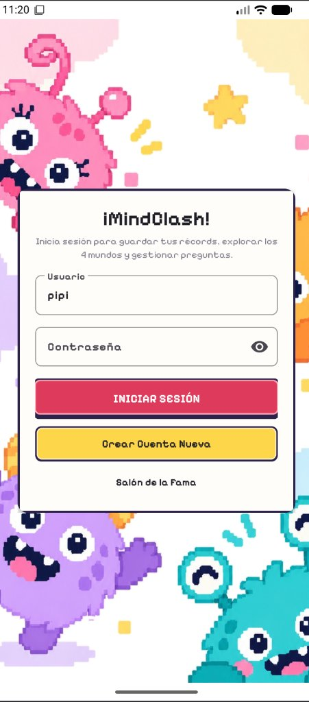
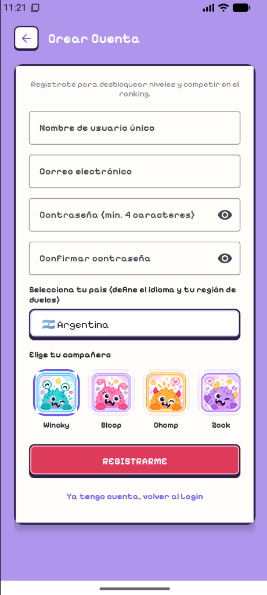
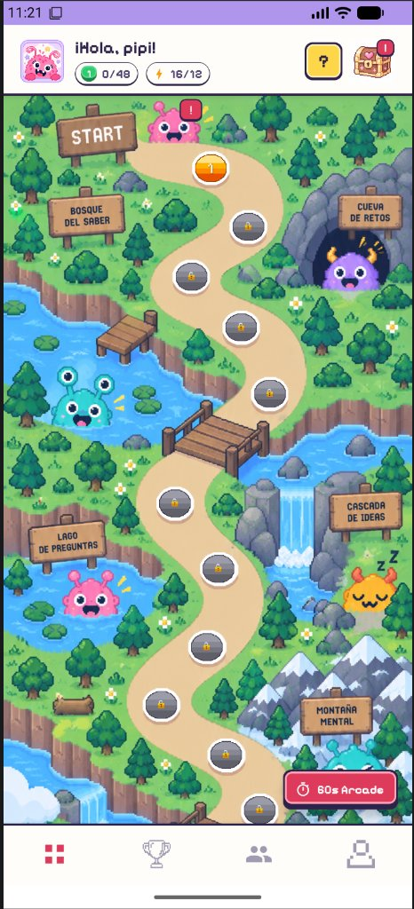
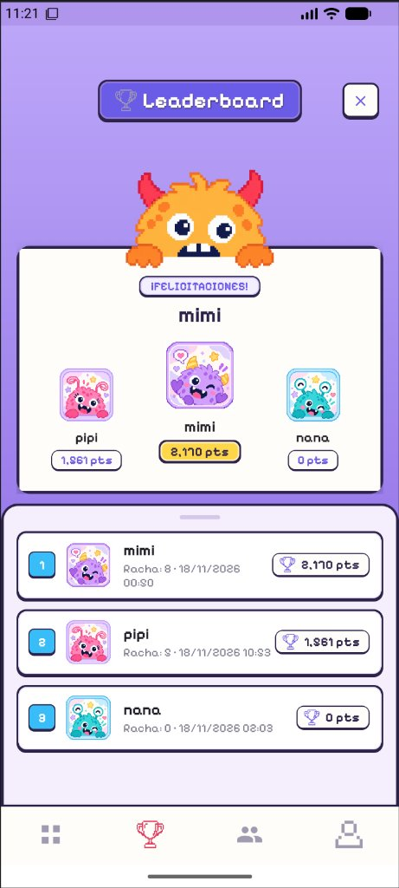
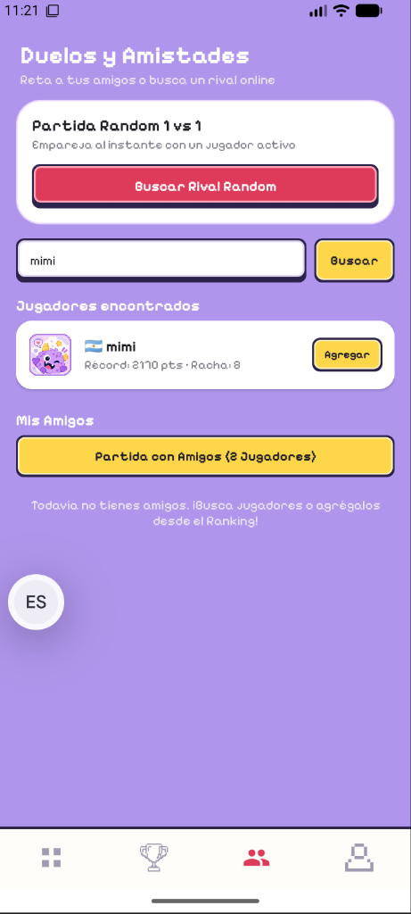
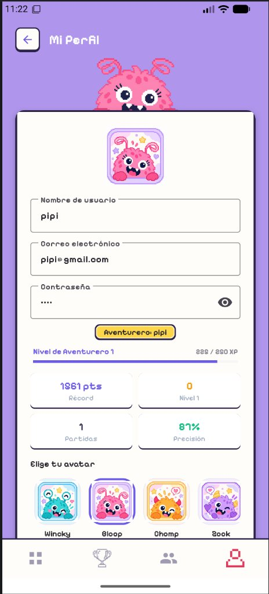

# TriviaMaster

Aplicación móvil nativa desarrollada en **Java** para Android con estética arcade pixel art retro y temática de monstruos. Evoluciona el sistema base integrando persistencia completa en **SQLite**, acceso asíncrono en hilos secundarios con `ExecutorService`, progresión RPG, tienda, misiones, duelos 1 vs 1 reales por red local y sistema de amistades.

---

## Capturas de la App

| Login (`MindClash`) | Registro + País / Idioma | Mapa Interactivo |
| :---: | :---: | :---: |
|  |  |  |

| Salón de la Fama | Duelos y Amistades | Perfil de Aventurero |
| :---: | :---: | :---: |
|  |  |  |

---

## Funcionalidades Principales

### 1. Splash Screen, Autenticación y Roles (SQLite)
- **Splash Screen animado** (`SplashActivity`): presentación inicial con animación overshoot de la mascota antes de ingresar al Login.
- **Login y Registro** (`MainActivity`, `RegisterActivity`): validación de credenciales en SQLite, usuario único (`UNIQUE COLLATE NOCASE`) y selector de avatar.
- **Aislamiento de roles (`ADMIN` vs `USER`)**: el administrador (`mimi`) accede a la gestión completa de usuarios y preguntas; los jugadores acceden al mapa, perfil, misiones, ranking y duelos.

### 2. Mapa Interactivo, Dificultades y Batallas contra Jefes
- **Roadmap de 16 niveles** distribuidos en **4 mundos temáticos** más el **Castillo Final** (`MapActivity`, `RoadmapLayout`).
- **6 zonas especiales y Cueva de Retos**: desafíos rápidos de 10 preguntas aleatorias con límite de 1 victoria por dificultad.
- **Batallas contra Jefes (niveles 4, 8, 12 y 16)**: barra de vida (HP) del Monstruo Jefe en pantalla con animación de daño por cada acierto y recompensas extra al derrotarlo.
- **3 niveles de dificultad**: *Principiante*, *Veterano* y *Leyenda* con variación real de tiempo, vidas y multiplicador de puntaje.
- **Comodines con energía**: *50/50* (o *Letra* en puzzles de palabras) y *+5s*.

### 3. Modos Especiales de Juego
- **Modo Contrarreloj 60s (Arcade)**: ronda frenética de 60 segundos continuos para responder la mayor cantidad de preguntas posibles y escalar en el Salón de la Fama.
- **Modo "Repasar Errores"**: cada pregunta fallada o expirada se guarda en SQLite (`wrong_question_ids`); desde el Perfil podés lanzar una ronda de repaso para practicarlas y limpiar tus errores al acertarlas.
- **Puzzles de Palabras y Explicaciones**: preguntas de opción múltiple, armado de palabras por letras y explicaciones educativas tras cada respuesta.

### 4. Progresión RPG, Economía y Recompensas
- **Nivel de Aventurero (XP) y Badge de Combo**: ganancia de XP tras cada partida con barra de progreso en el Perfil y badge animado `COMBO x2 / x3` durante la partida.
- **Misiones y Logros Reclamables** (`QuestsActivity`): panel con barra de progreso real (*Gana en dificultad Leyenda*, *Completa retos de monstruos*, *Consigue racha*, *Juega partidas*, etc.) para reclamar monedas y cofres.
- **Racha Diaria (Daily Streak)**: recompensa diaria por fecha calendario que escala las monedas (`+30`, `+50`, `+70`, hasta `+150` monedas + `+2` energía) al ingresar días consecutivos.
- **Tienda de Aventurero** (`ShopActivity`, integrada dentro de `ProfileActivity`): compra de Energía, Escudos protectores, Títulos equipables y Marcos de Avatar especiales (*Dorado*, *Neón*, *Fuego*).

### 5. Duelos 1 vs 1 Reales y Sistema de Amistades
- **Sección dedicada en la barra inferior** (`SocialActivity`):
  - **Partida Random 1 vs 1 en Red Local**: descubrimiento y conexión real en tu área mediante `NsdManager` (`_triviamaster._tcp.`) y `Socket` TCP (`LocalAreaMatchmaker`, `ActiveDuelSession`), sin bots ni simulaciones. Si no hay otro jugador conectado en tu área, la app informa que no hay jugadores disponibles en ese momento.
  - **Duelo Local (2 Jugadores)**: modalidad "Pasar y Jugar" en el mismo dispositivo con turnos alternados y temporizador de 15s.
  - **Amistades y Centro de Notificaciones en SQLite**: buscador de usuarios por nombre, envío de solicitudes pendientes (`PENDING`), **Centro de Notificaciones** (campanita con contador en Mapa y Duelos) para aceptar o rechazar solicitudes recibidas, y lista de amigos para desafiar 1 vs 1.
  - **País e Idioma Automático (ES / EN / IT)**: selector de 15 países con banderas al registrarse que traduce automáticamente toda la app y las 80 preguntas base (`QuestionTranslator`), emparejando duelos por país.
  - **Interacción desde el Ranking** (`RankingActivity`): tocá cualquier jugador del podio o de la tabla para enviarle solicitud de amistad o desafiarlo.

### 6. Gestión CRUD e Historial (SQLite)
- **CRUD de Usuarios** (`UserManagerActivity`): listado, búsqueda, alta, edición y baja de cuentas.
- **CRUD de Preguntas** (`QuestionManagerActivity`): creación, búsqueda, filtrado por nivel (1 al 16), edición y eliminación de preguntas personalizadas en SQLite.
- **Historial de Partidas** (`MatchHistoryActivity`): registro de cada partida jugada (modo, dificultad, aciertos, puntaje, estrellas y fecha) con eliminación individual o total.

---

## Arquitectura y Paquetes

- **Activities principales:** `SplashActivity`, `MainActivity`, `RegisterActivity`, `MapActivity`, `GameActivity`, `ResultActivity`, `SocialActivity`, `DuelActivity`, `RankingActivity`, `ProfileActivity`, `ShopActivity`, `QuestsActivity`, `UserManagerActivity`, `QuestionManagerActivity`, `MatchHistoryActivity`.
- **Persistencia (`data/db`):** `TriviaDbHelper` (SQLite **v10**: tablas `users`, `questions`, `match_history`, `friendships`), `DbExecutor`, `UserRepository`, `QuestionRepository`, `MatchHistoryRepository`, `FriendshipRepository`.
- **Red Local (`network`):** `LocalAreaMatchmaker` (`NsdManager` + `ServerSocket`/`Socket`), `ActiveDuelSession`.
- **Modelos y Utilidades (`models`, `adapters`, `utils`):** `User`, `Question`, `Level`, `Difficulty`, `Friendship`, `QuestItem`, `MatchHistoryItem`, `RankingItem`, `AvatarFrameHelper`, `RetroFeedbackManager`.

---

## Tecnologías y Requisitos

- **Lenguaje:** Java 17
- **Base de datos:** SQLite (`TriviaDbHelper`, versión 10)
- **Concurrencia:** `ExecutorService` + `Handler(Looper.getMainLooper())`
- **Red:** Android `NsdManager` + TCP `Socket` / `ServerSocket`
- **UI:** ViewBinding, Material Components, RecyclerView, ConstraintLayout, recursos en `strings.xml`
- **SDK Mínimo:** Android 7.0 (API 24) | **SDK Target:** Android 14 (API 34)
- **Pruebas unitarias:** JUnit 4 (`./gradlew testDebugUnitTest`)

---

## Autora

- **Alumna:** Camila Ianni
- **Materia:** Aplicaciones Móviles
- **Carrera:** Analista de Sistemas
